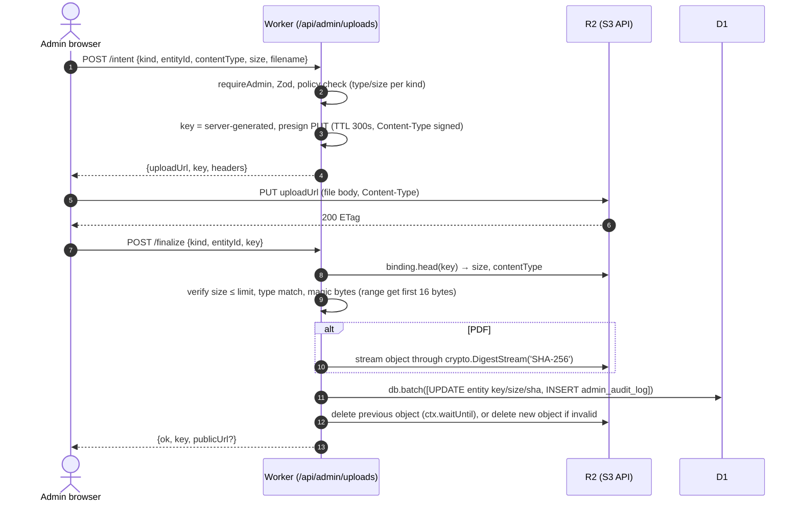

# Admin Architecture — `/admin`

Single-tenant back office for the site owner(s): multi-language content editing, catalog/e-book management, direct-to-R2 uploads, and read-only sales/audience analytics. Same Worker as the public site; no separate deployment.

```
src/app/admin/                      # NOT under [locale]; excluded from next-intl middleware
  layout.tsx                        # calls requireAdmin(); renders admin chrome
  posts/ , posts/[id]/              # list + side-by-side editor
  products/ , products/[id]/        # catalog + variants + PDF upload
  analytics/sales/ , analytics/subscribers/
  **/actions.ts                     # Server Actions: thin, same rules as Route Handlers
src/app/api/admin/uploads/{intent,finalize}/route.ts
src/services/admin/                 # auth.service, content.service, upload.service, analytics.service
src/repositories/analytics.repo.ts  # read-only aggregate queries
src/validators/admin/*.ts           # Zod for every action / upload payload
```

## 1. Authentication — Cloudflare Access + JWT verification in the Worker

**Mechanism:** Cloudflare Access (Zero Trust) self-hosted application covering `naifmutfak.com/admin*` and `naifmutfak.com/api/admin*`. Identity via One-time PIN or Google, policy = explicit email allowlist. Access issues the `CF_Authorization` cookie and injects `Cf-Access-Jwt-Assertion` on every proxied request. **We store no passwords and run no session table.**

The Worker independently verifies the JWT (Access can be misconfigured, routes renamed, or the Worker reached via `*.workers.dev`):

```ts
// src/services/admin/auth.service.ts
import { createRemoteJWKSet, jwtVerify } from 'jose'; // Web Crypto based, Workers-compatible

const jwksCache = new Map<string, ReturnType<typeof createRemoteJWKSet>>();

export async function verifyAccessJwt(token: string, env: AdminAuthEnv): Promise<AdminIdentity> {
  const issuer = `https://${env.CF_ACCESS_TEAM_DOMAIN}`;           // <team>.cloudflareaccess.com
  const jwks = jwksCache.get(issuer) ?? createRemoteJWKSet(new URL(`${issuer}/cdn-cgi/access/certs`));
  jwksCache.set(issuer, jwks);
  const { payload } = await jwtVerify(token, jwks, { issuer, audience: env.CF_ACCESS_AUD, algorithms: ['RS256'] });
  const claims = accessClaimsSchema.parse(payload);                // Zod: { email, sub, exp, iat }
  if (!env.ADMIN_EMAILS.includes(claims.email.toLowerCase())) throw new AdminForbiddenError();
  return { email: claims.email.toLowerCase(), sub: claims.sub };
}
```

| Layer | Check |
|---|---|
| Edge | Cloudflare Access policy (allowlist, session 24h, require MFA-capable IdP). |
| `middleware.ts` | Matcher `/admin/:path*`, `/api/admin/:path*` → verify JWT, 403 on failure. Fast reject only — **not** the security boundary. |
| `requireAdmin()` | Called at the top of `admin/layout.tsx`, **every** Server Action, and **every** `/api/admin` handler. This is the boundary (middleware alone is bypassable by matcher drift). |
| Worker config | `workers_dev: false` and `preview_urls: false` in `wrangler.jsonc` so Access cannot be sidestepped. |

Env (Zod-validated): `CF_ACCESS_TEAM_DOMAIN`, `CF_ACCESS_AUD`, `ADMIN_EMAILS` (comma list → `string[]`). Token source: `Cf-Access-Jwt-Assertion` header, falling back to `CF_Authorization` cookie.

**Local dev:** Access is absent. `requireAdmin()` accepts `ADMIN_DEV_EMAIL` only when `ENVIRONMENT === 'development'` **and** the request host is `localhost`/`127.0.0.1`. Production config validation fails if `ADMIN_DEV_EMAIL` is set.

**CSRF:** Server Actions enforce same-origin (`Origin` header check by Next). `/api/admin/*` handlers additionally require `Origin` = site origin and `Content-Type: application/json`.

**Audit:** every mutation writes `admin_audit_log` (actor email, action, entity, minimal diff) in the same `db.batch` as the change.

## 2. Multi-Language Content Editor

Route: `/admin/posts/[id]`. One post = shared fields (`posts`) + up to three `post_translations` rows.

```
┌──────────────────────── Post: Ekşi Mayalı Ekmek ───────────────── [Save draft] [Publish ▾] ┐
│ SHARED (posts)                                                                             │
│ Status ▾  Category ▾  Recipe ☑  Prep [20] Cook [35] Rest [60] Servings [8]  Difficulty ▾   │
│ Hero image [upload/replace]   Featured e-book ▾                                            │
├──────────────────────────────────────────────────────────────────────────────────────────┤
│ [TR ●] [EN ●] [AR ○]          View: (•) Tabs  ( ) Side-by-side [TR ▾] ↔ [AR ▾]             │
│ ┌──────────── TR (ltr) ─────────────┐ ┌──────────── AR (dir=rtl) ─────────────┐            │
│ │ Title / Slug (auto, editable)      │ │ العنوان / slug                        │            │
│ │ Dek, SEO title, SEO description    │ │ …                                    │            │
│ │ Body (Markdown + ::ebook directive)│ │ …                                    │            │
│ │ Ingredients (structured rows)      │ │ Ingredients (same ids, local names)  │            │
│ │ Instructions (sections → steps)    │ │ …                                    │            │
│ │ Published in TR ☑                  │ │ Published in AR ☐                    │            │
│ └────────────────────────────────────┘ └──────────────────────────────────────┘            │
│ Live preview ▸ (renders public components with draft data, per locale)                      │
└──────────────────────────────────────────────────────────────────────────────────────────┘
```

| Concern | Spec |
|---|---|
| Tabs | One tab per locale with completeness dot (● complete, ◐ missing required fields, ○ not started). Side-by-side mode picks any two locales — typical flow: TR source on `start`, translation on `end`. |
| Direction | Each locale pane sets `dir` and `lang`; AR pane uses Arabic fonts. Inputs use logical CSS. |
| Structured ingredients | Row editor: quantity, max, unit, unitGrams, name, note, scalable. Row `id`s are generated once and shared across locales. "Copy structure from TR" clones groups/ids/quantities and blanks names for translation. A diff validator warns when ids or quantities differ across locales (quantities must match unless intentionally overridden). |
| Instructions | Sections → steps, drag to reorder, optional step image (upload flow below), optional timer. |
| Body | Markdown editor (CodeMirror 6) with toolbar for headings, links, images, and `::ebook{product=…}` picker. Preview rendered by the same remark pipeline as the public site (no eval). |
| Slugs | Generated per locale (`tr` transliteration: ç→c, ğ→g, ı→i, ö→o, ş→s, ü→u; `ar` → Latin transliteration or manual). Uniqueness per `(locale, slug)` checked on blur. |
| Validation | Same Zod schemas as `validators/content.ts`; the client uses them for inline errors, the Server Action re-validates (client validation is UX only). |
| Saving | Server Action `savePost({ post, translations[], expectedUpdatedAt })`. Optimistic concurrency: if `posts.updated_at ≠ expectedUpdatedAt` → 409 "edited elsewhere" with reload prompt. Unsaved changes autosaved to `localStorage` (`nm:admin:draft:{postId}`) and `beforeunload` guard. |
| Publishing | Post-level `status` + per-locale `is_published`. Publish requires the locale's required fields + valid JSON-LD (dry-run `recipe-jsonld` generation). On publish: set `published_at` if null, then `revalidatePath('/{locale}/…')` / tag revalidation for affected locales. |
| Products | `/admin/products/[id]` mirrors the pattern: shared fields + `product_translations` tabs + variants table (content locale, SKU, TRY/USD/SAR prices in major units converted to minor on save, MoR IDs, PDF upload, active toggle). Activation requires PDF present and MoR ID set for the active provider. |

### 2.1 Auto-translation (TR → EN/AR, Workers AI)

Design: `docs/superpowers/specs/2026-11-16-auto-translation-design.md`. Free tooling only (Workers AI free allocation, 10,000 Neurons/day, resets 00:00 UTC).

| Concern | Spec |
|---|---|
| Trigger | "Automatic translation" card above the content tabs. One button per target locale; disabled while the form has unsaved changes or the TR title is empty. One locale per request (`translatePostAction` → `services/admin/post-translate.service.ts`). |
| Flow | Saved TR row → (1) strings-only JSON payload to `AI_TRANSLATE_MODEL` (1 retry on unusable JSON) → (2) body Markdown in ≤ 12,000-char chunks (fences / `:::` containers never split) → merge → deterministic checks → (3) review by `AI_REVIEW_MODEL` → `saveAiTranslation`. |
| Numbers never leave the server | The model only sees and returns text keyed by ingredient/step `id`. Quantities, `unitGrams`, timers, image keys and structure are copied from TR by code (`services/translation/payload.ts`); unknown ids are ignored, missing ones keep the TR text and are reported. |
| Write | Upsert of that locale with `is_published = 0`; `posts.updated_at` (editor token) is untouched. Slug: existing slug kept; else `slugify(title)`, fallback `{trSlug}-{locale}`, suffixes `-2…-9`. Audit `post.translate` with counts only. |
| Metadata | `post_translations.ai_source_hash`, `ai_content_hash`, `ai_report_json`, `ai_translated_at`. Hash = SHA-256 of a normalised text-only projection (`services/translation/content-hash.ts`), stable through the editor's form round-trip. |
| Origin / out of date | No row → `none`; row without metadata → `manual`; content hash matches → `ai`; else `ai_edited`. `outdated` = TR hash ≠ `ai_source_hash`. |
| Overwrite guard | `manual`, `ai_edited` or published rows need explicit confirmation (`overwrite: true`); confirming unpublishes the row and revalidates its old paths. |
| Checks (code) | `missing_item`, `untranslated`, `clamped` (column limits), `wrong_script`, `numbers` (Arabic-Indic digits normalised), `body_headings`, `body_lists`, `body_links`, `body_directives`. |
| Review (AI) | Up to 20 issues, Turkish one-sentence messages, rendered as plain text. Any review failure saves the translation with `reviewed: false`. |
| Errors | `quota` (3036 daily allocation), `ai_unavailable` (capacity 3040, network, no binding), `model_output`, `source_missing`, `needs_confirm`, `slug`. Nothing is written on any error before step 3. |
| Models | `vars.AI_TRANSLATE_MODEL` / `AI_REVIEW_MODEL` in `wrangler.jsonc`. `lib/cloudflare/ai.ts` accepts only ids in its typed enum (currently `@cf/google/gemma-4-26b-a4b-it`, `@cf/zai-org/glm-4.7-flash`): swapping = add the id there + change the var. Thinking is disabled (`enable_thinking: false`). |
| Local dev | `AI` is a remote-only binding. `next dev` connects remote bindings only with `CF_REMOTE_BINDINGS=true` in `.env.local` after `npx wrangler login` (real Neurons are spent); otherwise translation reports `ai_unavailable`. Integration tests use `remoteBindings: false`. |
| Cost | Not yet measured. After the first real run, record "≈ N Neurons per recipe (EN + AR)" here from the Workers AI dashboard. |

## 3. Direct R2 Uploads — presigned PUT

R2 bindings cannot presign, so presigning uses R2's S3-compatible API with `aws4fetch` (Web Crypto, Workers-safe). The browser uploads directly to R2; file bytes never pass through the Worker.



| Kind | Bucket | Key pattern | Types | Max size |
|---|---|---|---|---|
| `post_hero`, `step_image` | `MEDIA_PUBLIC` | `posts/{postId}/{uuid}.{ext}` | jpeg, png, webp, avif | 15 MB |
| `product_cover` | `MEDIA_PUBLIC` | `products/{productId}/{uuid}.{ext}` | jpeg, png, webp | 10 MB |
| `ebook_pdf` | `EBOOKS_PRIVATE` | `ebooks/{productId}/{variantId}/{uuid}.pdf` | application/pdf (`%PDF-` magic) | 200 MB |

```ts
// src/lib/cloudflare/r2-presign.ts
import { AwsClient } from 'aws4fetch';

export async function presignPut(env: R2PresignEnv, bucket: string, key: string, contentType: string): Promise<string> {
  const client = new AwsClient({ accessKeyId: env.R2_ACCESS_KEY_ID, secretAccessKey: env.R2_SECRET_ACCESS_KEY, service: 's3', region: 'auto' });
  const url = new URL(`https://${env.R2_ACCOUNT_ID}.r2.cloudflarestorage.com/${bucket}/${encodeURI(key)}`);
  url.searchParams.set('X-Amz-Expires', '300');
  const signed = await client.sign(new Request(url, { method: 'PUT', headers: { 'Content-Type': contentType } }), { aws: { signQuery: true } });
  return signed.url;
}
```

Rules:
- Keys are always server-generated (UUID); client filenames are used only for `Content-Disposition` metadata, never in keys.
- R2 presigned PUT cannot enforce a size cap, so `finalize` enforces it and deletes oversized/mismatched objects. Orphans (intent without finalize) are removed by a daily Cron listing objects newer than 24h that no row references.
- R2 API token: **Object Read & Write scoped to `MEDIA_PUBLIC` and `EBOOKS_PRIVATE` only**. Secrets `R2_ACCESS_KEY_ID`, `R2_SECRET_ACCESS_KEY`, var `R2_ACCOUNT_ID`.
- Bucket CORS: `AllowedOrigins: [https://naifmutfak.com, http://localhost:3000]`, `AllowedMethods: [PUT]`, `AllowedHeaders: [content-type]`, `MaxAgeSeconds: 3600`. Public reads on `MEDIA_PUBLIC` go through its custom domain, not CORS.
- Replacing a PDF on an active variant keeps old purchasers working: the new key is written atomically, the old object deleted afterwards.
- Images are stored as originals; optimized delivery is done by Cloudflare Image Transformations (editorial-system.md §3).

## 4. Read-Only Analytics

Source: D1 only (`orders`, `webhook_events`, `subscribers`). All queries in `repositories/analytics.repo.ts`, `SELECT` only, parameterized, date range ≤ 366 days, results cached 60s via the Cache API keyed by query + range.

**Sales (`/admin/analytics/sales`)**

| View | Query basis | Notes |
|---|---|---|
| KPI tiles | `status='paid'` within range: orders count, gross per currency, refunds count/amount, refund rate | **Revenue is never summed across currencies** — one tile per TRY/USD/SAR. |
| Revenue over time | `GROUP BY currency, date(paid_at,'unixepoch')` (day/week/month) | Line per currency. |
| By product & edition | join `product_variants` → `GROUP BY product_id, content_locale` | Shows which language editions sell. |
| By buyer locale | `GROUP BY customer_locale` | Storefront locale at checkout. |
| Checkout conversion | `paid / (paid + pending older than 1h + failed)` | Approximate; pending rows are purged after 48h. |
| Orders table | paginated (cursor on `created_at,id`), filters: status, provider, currency, product | Email masked `a***@domain` by default; "reveal" is an explicit action written to `admin_audit_log`. |
| Webhook health | `webhook_events` by `outcome` last 7 days; list of `failed` with error code | Variant-mismatch review queue. |

**Subscribers (`/admin/analytics/subscribers`)**

| View | Query basis |
|---|---|
| KPI tiles | active, pending (unconfirmed), unsubscribed, bounced; net growth in range |
| Growth over time | `GROUP BY date(created_at), status` |
| By locale / by source | `GROUP BY locale` · `GROUP BY source` (footer, recipe_card, ebook_callout, popup, checkout) |
| Confirmation rate | `confirmed_at IS NOT NULL / total` per source |
| Table | paginated, masked emails, filters by status/locale/source |

Exports: CSV download (`text/csv`, streamed) of the current filtered table; masked unless the export action is explicitly "unmasked", which is audited. No write actions on analytics pages; refunds and customer changes are performed in the MoR dashboard.

Charts: server-rendered SVG components using the design tokens (no client charting library for v1).
