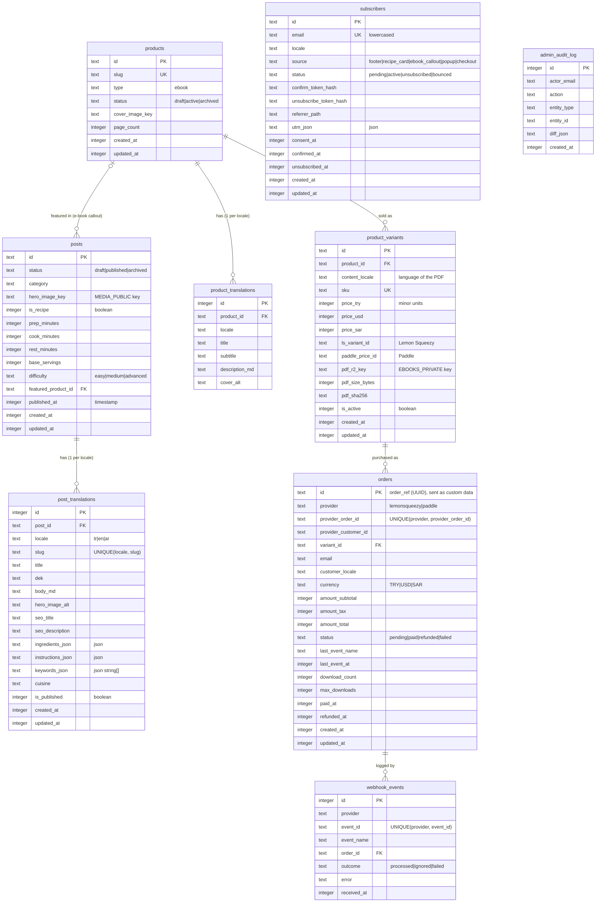

# Database Architecture — D1 (SQLite) + Drizzle

Source of truth: `src/db/schema.ts`. Driver: `drizzle-orm/d1`. Migrations: `/migrations` (generated by `drizzle-kit`, applied by `wrangler d1 migrations apply`).

## Conventions

| Concern | Rule |
|---|---|
| Primary keys | `text` UUID v4 (`crypto.randomUUID()`) for exposed entities; `integer` autoincrement for internal rows (translations, logs). |
| Timestamps | `integer(col, { mode: 'timestamp' })` (unix seconds). Default `sql\`(unixepoch())\``; `updatedAt` uses `$onUpdate(() => new Date())`. |
| Booleans | `integer(col, { mode: 'boolean' })`. |
| JSON | `text(col, { mode: 'json' }).$type<T>()`; `T` inferred from a Zod schema in `src/validators/content.ts`. Validate on write. |
| Enums | `text(col, { enum: [...] })` backed by `as const` tuples shared with Zod (`z.enum(LOCALES)`). |
| Money | Integer minor units (kuruş, cents, halalas). Never floats. Never sum across currencies. |
| Deletes | FKs `onDelete: 'cascade'` for owned children (translations); `'restrict'` for financial references (orders → variants). |
| Writes | Multi-statement writes via `db.batch([...])`. Idempotent inserts via `.onConflictDoNothing()` / `.onConflictDoUpdate()`. |
| Naming | snake_case columns in SQL, camelCase in TS. |

## ERD



## JSON Column Contracts (`src/validators/content.ts`)

Ingredient quantities are numeric to support the Recipe Card servings multiplier and map 1:1 to JSON-LD `recipeIngredient` / `recipeInstructions` (`HowToSection` → `HowToStep`).

```ts
import { z } from 'zod';

export const LOCALES = ['tr', 'en', 'ar'] as const;
export const CURRENCIES = ['TRY', 'USD', 'SAR'] as const;

export const ingredientSchema = z.object({
  id: z.string().min(1),                       // stable across locales (checkbox state, cross-locale diff)
  quantity: z.number().positive().nullable(),  // null = "to taste"
  quantityMax: z.number().positive().optional(), // ranges: 2–3
  unit: z.string().max(24).optional(),         // localized display unit ("g", "su bardağı", "كوب")
  unitGrams: z.number().positive().optional(), // optional metric equivalent per 1 unit
  name: z.string().min(1).max(200),
  note: z.string().max(200).optional(),        // "room temperature"
  scalable: z.boolean().default(true),         // false for e.g. "1 pinch salt"
});
export const ingredientGroupSchema = z.object({
  title: z.string().max(120).optional(),       // "For the dough"
  items: z.array(ingredientSchema).min(1),
});
export const ingredientsSchema = z.array(ingredientGroupSchema).max(20);

export const instructionStepSchema = z.object({
  id: z.string().min(1),
  text: z.string().min(1).max(2000),
  imageKey: z.string().optional(),             // MEDIA_PUBLIC key
  timerSeconds: z.number().int().positive().optional(),
});
export const instructionSectionSchema = z.object({
  title: z.string().max(120).optional(),
  steps: z.array(instructionStepSchema).min(1),
});
export const instructionsSchema = z.array(instructionSectionSchema).max(20);

export const utmSchema = z.object({
  source: z.string().max(100).optional(),
  medium: z.string().max(100).optional(),
  campaign: z.string().max(100).optional(),
});

export type Ingredients = z.infer<typeof ingredientsSchema>;
export type Instructions = z.infer<typeof instructionsSchema>;
export type Utm = z.infer<typeof utmSchema>;
```

## Drizzle Schema (`src/db/schema.ts`)

```ts
import { sql } from 'drizzle-orm';
import { sqliteTable, text, integer, index, uniqueIndex } from 'drizzle-orm/sqlite-core';
import { LOCALES, CURRENCIES, type Ingredients, type Instructions, type Utm } from '@/validators/content';

const createdAt = () =>
  integer('created_at', { mode: 'timestamp' }).notNull().default(sql`(unixepoch())`);
const updatedAt = () =>
  integer('updated_at', { mode: 'timestamp' }).notNull().default(sql`(unixepoch())`).$onUpdate(() => new Date());

/* ───────────── Content ───────────── */

export const posts = sqliteTable('posts', {
  id: text('id').primaryKey().$defaultFn(() => crypto.randomUUID()),
  status: text('status', { enum: ['draft', 'published', 'archived'] }).notNull().default('draft'),
  category: text('category').notNull(),
  heroImageKey: text('hero_image_key'),
  isRecipe: integer('is_recipe', { mode: 'boolean' }).notNull().default(true),
  prepMinutes: integer('prep_minutes'),
  cookMinutes: integer('cook_minutes'),
  restMinutes: integer('rest_minutes'),
  baseServings: integer('base_servings'),
  difficulty: text('difficulty', { enum: ['easy', 'medium', 'advanced'] }),
  featuredProductId: text('featured_product_id').references(() => products.id, { onDelete: 'set null' }),
  publishedAt: integer('published_at', { mode: 'timestamp' }),
  createdAt: createdAt(),
  updatedAt: updatedAt(),
}, (t) => [
  index('posts_status_published_idx').on(t.status, t.publishedAt),
  index('posts_category_idx').on(t.category),
]);

export const postTranslations = sqliteTable('post_translations', {
  id: integer('id').primaryKey({ autoIncrement: true }),
  postId: text('post_id').notNull().references(() => posts.id, { onDelete: 'cascade' }),
  locale: text('locale', { enum: LOCALES }).notNull(),
  slug: text('slug').notNull(),
  title: text('title').notNull(),
  dek: text('dek'),
  bodyMd: text('body_md').notNull().default(''),
  heroImageAlt: text('hero_image_alt'),
  seoTitle: text('seo_title'),
  seoDescription: text('seo_description'),
  ingredientsJson: text('ingredients_json', { mode: 'json' }).$type<Ingredients>(),
  instructionsJson: text('instructions_json', { mode: 'json' }).$type<Instructions>(),
  keywordsJson: text('keywords_json', { mode: 'json' }).$type<string[]>(),
  cuisine: text('cuisine'),
  isPublished: integer('is_published', { mode: 'boolean' }).notNull().default(false),
  createdAt: createdAt(),
  updatedAt: updatedAt(),
}, (t) => [
  uniqueIndex('post_translations_post_locale_uq').on(t.postId, t.locale),
  uniqueIndex('post_translations_locale_slug_uq').on(t.locale, t.slug),
  index('post_translations_locale_pub_idx').on(t.locale, t.isPublished),
]);

/* ───────────── Commerce ───────────── */

export const products = sqliteTable('products', {
  id: text('id').primaryKey().$defaultFn(() => crypto.randomUUID()),
  slug: text('slug').notNull().unique(),
  type: text('type', { enum: ['ebook'] }).notNull().default('ebook'),
  status: text('status', { enum: ['draft', 'active', 'archived'] }).notNull().default('draft'),
  coverImageKey: text('cover_image_key'),
  pageCount: integer('page_count'),
  createdAt: createdAt(),
  updatedAt: updatedAt(),
});

export const productTranslations = sqliteTable('product_translations', {
  id: integer('id').primaryKey({ autoIncrement: true }),
  productId: text('product_id').notNull().references(() => products.id, { onDelete: 'cascade' }),
  locale: text('locale', { enum: LOCALES }).notNull(),
  title: text('title').notNull(),
  subtitle: text('subtitle'),
  descriptionMd: text('description_md').notNull().default(''),
  coverAlt: text('cover_alt'),
}, (t) => [uniqueIndex('product_translations_product_locale_uq').on(t.productId, t.locale)]);

export const productVariants = sqliteTable('product_variants', {
  id: text('id').primaryKey().$defaultFn(() => crypto.randomUUID()),
  productId: text('product_id').notNull().references(() => products.id, { onDelete: 'cascade' }),
  contentLocale: text('content_locale', { enum: LOCALES }).notNull(),
  sku: text('sku').notNull().unique(),
  priceTry: integer('price_try').notNull(),
  priceUsd: integer('price_usd').notNull(),
  priceSar: integer('price_sar').notNull(),
  lsVariantId: text('ls_variant_id'),
  paddlePriceId: text('paddle_price_id'),
  pdfR2Key: text('pdf_r2_key'),
  pdfSizeBytes: integer('pdf_size_bytes'),
  pdfSha256: text('pdf_sha256'),
  isActive: integer('is_active', { mode: 'boolean' }).notNull().default(false),
  createdAt: createdAt(),
  updatedAt: updatedAt(),
}, (t) => [
  uniqueIndex('product_variants_product_locale_uq').on(t.productId, t.contentLocale),
  uniqueIndex('product_variants_ls_uq').on(t.lsVariantId),
  uniqueIndex('product_variants_paddle_uq').on(t.paddlePriceId),
]);

export const orders = sqliteTable('orders', {
  id: text('id').primaryKey(), // order_ref, generated server-side before checkout opens
  provider: text('provider', { enum: ['lemonsqueezy', 'paddle'] }).notNull(),
  providerOrderId: text('provider_order_id'),
  providerCustomerId: text('provider_customer_id'),
  variantId: text('variant_id').notNull().references(() => productVariants.id, { onDelete: 'restrict' }),
  email: text('email'),
  customerLocale: text('customer_locale', { enum: LOCALES }).notNull(),
  currency: text('currency', { enum: CURRENCIES }),
  amountSubtotal: integer('amount_subtotal'),
  amountTax: integer('amount_tax'),
  amountTotal: integer('amount_total'),
  status: text('status', { enum: ['pending', 'paid', 'refunded', 'failed'] }).notNull().default('pending'),
  lastEventName: text('last_event_name'),
  lastEventAt: integer('last_event_at', { mode: 'timestamp' }),
  downloadCount: integer('download_count').notNull().default(0),
  maxDownloads: integer('max_downloads').notNull().default(10),
  paidAt: integer('paid_at', { mode: 'timestamp' }),
  refundedAt: integer('refunded_at', { mode: 'timestamp' }),
  createdAt: createdAt(),
  updatedAt: updatedAt(),
}, (t) => [
  uniqueIndex('orders_provider_order_uq').on(t.provider, t.providerOrderId),
  index('orders_status_paid_idx').on(t.status, t.paidAt),
  index('orders_email_idx').on(t.email),
]);

export const webhookEvents = sqliteTable('webhook_events', {
  id: integer('id').primaryKey({ autoIncrement: true }),
  provider: text('provider', { enum: ['lemonsqueezy', 'paddle'] }).notNull(),
  eventId: text('event_id').notNull(), // Paddle: event_id; Lemon Squeezy: SHA-256 hex of raw body
  eventName: text('event_name').notNull(),
  orderId: text('order_id').references(() => orders.id, { onDelete: 'set null' }),
  outcome: text('outcome', { enum: ['processed', 'ignored', 'failed'] }).notNull(),
  error: text('error'),
  receivedAt: integer('received_at', { mode: 'timestamp' }).notNull().default(sql`(unixepoch())`),
}, (t) => [uniqueIndex('webhook_events_provider_event_uq').on(t.provider, t.eventId)]);

/* ───────────── Audience ───────────── */

export const subscribers = sqliteTable('subscribers', {
  id: text('id').primaryKey().$defaultFn(() => crypto.randomUUID()),
  email: text('email').notNull().unique(), // normalized: trim + lowercase
  locale: text('locale', { enum: LOCALES }).notNull(),
  source: text('source', { enum: ['footer', 'recipe_card', 'ebook_callout', 'popup', 'checkout'] }).notNull(),
  status: text('status', { enum: ['pending', 'active', 'unsubscribed', 'bounced'] }).notNull().default('pending'),
  confirmTokenHash: text('confirm_token_hash'),       // SHA-256 of token; raw token only in email
  unsubscribeTokenHash: text('unsubscribe_token_hash'),
  referrerPath: text('referrer_path'),
  utmJson: text('utm_json', { mode: 'json' }).$type<Utm>(),
  consentAt: integer('consent_at', { mode: 'timestamp' }).notNull(),
  confirmedAt: integer('confirmed_at', { mode: 'timestamp' }),
  unsubscribedAt: integer('unsubscribed_at', { mode: 'timestamp' }),
  createdAt: createdAt(),
  updatedAt: updatedAt(),
}, (t) => [
  index('subscribers_status_locale_idx').on(t.status, t.locale),
  index('subscribers_source_idx').on(t.source),
]);

/* ───────────── Admin ───────────── */

export const adminAuditLog = sqliteTable('admin_audit_log', {
  id: integer('id').primaryKey({ autoIncrement: true }),
  actorEmail: text('actor_email').notNull(),
  action: text('action').notNull(),       // e.g. "post.update", "variant.pdf.replace"
  entityType: text('entity_type').notNull(),
  entityId: text('entity_id').notNull(),
  diffJson: text('diff_json', { mode: 'json' }).$type<Record<string, unknown>>(),
  createdAt: createdAt(),
}, (t) => [index('admin_audit_entity_idx').on(t.entityType, t.entityId)]);
```

## Query Rules

- **Public post listing:** `posts.status = 'published' AND post_translations.is_published = 1 AND locale = ?`, ordered by `published_at DESC`. A post can exist in TR only; missing locales 404 (no silent fallback) and are omitted from `hreflang`.
- **Slug lookup:** `(locale, slug)` unique index → single indexed read. Alternates for `hreflang` via `post_id`.
- **Pricing:** locale → currency map (`tr→TRY`, `en→USD`, `ar→SAR`) in `src/i18n/currency.ts`; display price from `product_variants`. The amount actually charged is whatever the MoR reports in the webhook and is stored on `orders` — that is the financial record.
- **Lemon Squeezy note:** a store has one settlement currency; multi-currency display is handled by LS localization. Our `price_*` columns are catalog/display values and must be kept in sync with provider configuration (Paddle: one price with `unit_price_overrides`).
- **Idempotency:** insert into `webhook_events` with `onConflictDoNothing()` first; if no row inserted → duplicate, return 200 without side effects. See payments.md.
- **Subscribers:** upsert by email; re-subscribing an `unsubscribed` address resets to `pending` and requires double opt-in again.

## Migration Workflow

1. Edit `src/db/schema.ts`.
2. `npm run db:generate` → `drizzle-kit generate` writes SQL to `/migrations` (wrangler `migrations_dir`).
3. Review SQL (SQLite cannot `ALTER COLUMN`; drizzle-kit emits table rebuilds — check data copy).
4. `npx wrangler d1 migrations apply naif-mutfak-db --local` → run tests/seed locally.
5. Remote apply (`--remote`) only after local verification and explicit approval.
